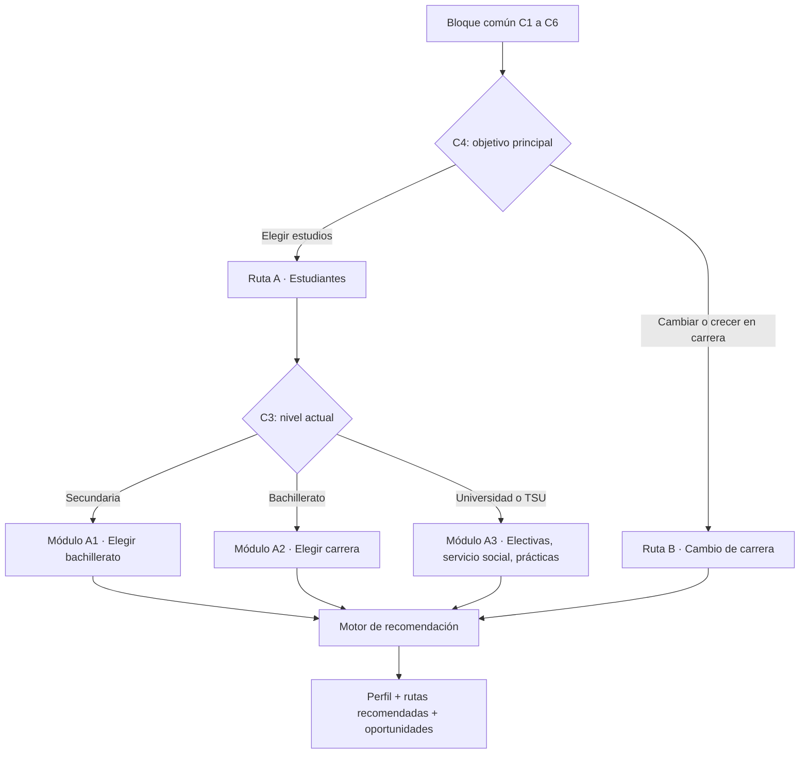

# 02 · Cuestionario vocacional de dos rutas

> Paso 1 del plan aprobado. Diseño del instrumento, su lógica de ramificación y las recomendaciones que produce. Los datos citados están en [04-evidencia-reportes.md](04-evidencia-reportes.md) y el contrato de salida en [03-modelo-de-salida.md](03-modelo-de-salida.md).

## 1. Por qué este cuestionario y no otro

La evidencia apunta a tres fallas que el instrumento debe corregir:

1. **Incertidumbre vocacional alta.** Tres de cada diez estudiantes de 15 años en México no tienen plan de carrera, proporción que se cuadruplicó desde 2015 (IMCO, *Compara Carreras 2025*, con datos de la OCDE).
2. **Aspiraciones desalineadas con la economía real.** Siete de cada diez jóvenes aspiran a empleos profesionales que representan 9.5% del mercado laboral, y 46% de la matrícula universitaria se concentra en diez carreras tradicionales (IMCO, 2025).
3. **Señales de contratación en transición.** En México, 94% de los empleadores prioriza candidatos con microcredenciales (Coursera, *Global Skills Report 2025*), pero sólo uno de cada cinco planea priorizar habilidades sobre títulos (IMCO, *Tendencias Educativas*). El título sigue importando y deja de ser suficiente.

Por eso el cuestionario **no sólo pregunta qué le gusta a la persona**: cruza intereses con demanda observada, accesibilidad económica y oferta regional, y explica cada recomendación con su fuente. Esto responde directamente a la propuesta 3 del IMCO: orientación vocacional basada en evidencia, con datos de oferta educativa, demanda laboral y salarios.

## 2. Principios de diseño

| Principio | Decisión concreta |
|---|---|
| Corto | Bloque común de 6 preguntas y 12 a 16 por ruta. Meta: completar en 10 minutos o menos. |
| Explicable | Cada recomendación muestra por qué aparece, con la cifra y la fuente. Sin "caja negra". |
| Honesto | Si una carrera tiene demanda en descenso (por ejemplo, Contabilidad o Administración: −20% a −25% según el WEF citado por el IMCO), se dice, aunque sea la preferencia de la persona. |
| Menores protegidos | Para menores de 18 años: sin nombre, correo ni teléfono obligatorios; resultados en el dispositivo; consentimiento de madre, padre o tutor para cualquier dato guardado. |
| Accesible | Funciona en móvil (48% de quienes aprenden en Coursera en México lo hacen desde el móvil) y no exige conectividad continua. |
| Retroalimentable | Las salidas están estructuradas para alimentar el catálogo (paso 2), el loop semanal (paso 3) y el prototipo (paso 4). |

## 3. Flujo general



Una persona universitaria que ya trabaja puede tomar las dos rutas; el sistema guarda ambas salidas y las fusiona.

## 4. Bloque común (todas las personas)

| ID | Pregunta | Tipo | Opciones o formato | Uso |
|---|---|---|---|---|
| C1 | ¿Cuál es tu rango de edad? | Opción única | 12–14, 15–17, 18–22, 23–29, 30–39, 40 o más | Activa protección de menores; filtra programas por edad (p. ej., JA México atiende de 7 a 29 años). |
| C2 | ¿En qué estado vives? | Lista | 32 entidades + "Fuera de México" (país) | Oferta educativa y vacantes locales; entidades con especialización STEM (7 en 2025, IMCO). |
| C3 | ¿Cuál es tu nivel de estudios actual? | Opción única | Secundaria en curso; bachillerato en curso; bachillerato terminado; TSU o licenciatura en curso; licenciatura terminada; posgrado; carrera técnica; sin estudios formales en curso | Enrutamiento. |
| C4 | ¿Qué buscas principalmente? | Opción única | Elegir qué estudiar; complementar mis estudios (prácticas, servicio social, certificaciones); cambiar de carrera o de área; crecer en mi área actual | Elige ruta A o B. |
| C5 | ¿Cuántas horas a la semana puedes dedicar a formarte? | Opción única | Menos de 3; 3–5; 6–10; 11–20; más de 20 | Filtra cursos y bootcamps (Generation México: horario completo de 9:30 a 17:30). |
| C6 | ¿Cuánto puedes invertir en formación en los próximos 6 meses? | Opción única | Nada (sólo gratuito); hasta $1,000 MXN; $1,000–5,000; $5,000–15,000; más de $15,000 | Prioriza vouchers, retos y programas gratuitos. |

## 5. Ruta A · Estudiantes (secundaria a universidad)

### 5.1 Preguntas compartidas de la ruta A

| ID | Pregunta | Tipo | Opciones o formato | Uso |
|---|---|---|---|---|
| A1 | ¿Qué actividades disfrutas? (elige hasta 4) | Opción múltiple | Construir o reparar cosas; programar o usar computadoras a fondo; experimentar en laboratorio; cuidar la salud de personas o animales; analizar datos o resolver acertijos; diseñar o dibujar; cuidar el medio ambiente; organizar proyectos o equipos; enseñar o explicar; vender o convencer | Perfil de intereses adaptado de RIASEC y mapeado a familias STEM. |
| A2 | Califica de 1 a 5 cuánto te gustan estas materias | Escala por materia | Matemáticas; Física; Química; Biología; Informática o tecnología; Inglés; Español o redacción; Ciencias sociales; Artes | Afinidad académica (gusto, no calificación). |
| A3 | ¿Cómo te va en Matemáticas y Ciencias? | Opción única | Me cuesta; promedio; bien; muy bien | Señala necesidad de refuerzo, nunca descarta una ruta. |
| A4 | ¿Qué problemas te gustaría ayudar a resolver? (hasta 3) | Opción múltiple | Salud; energía y clima; agua y alimentos; ciudades y movilidad; seguridad digital; manufactura y autos; espacio; educación; finanzas personales | Conecta interés con industria. |
| A5 | ¿En qué industrias te imaginas trabajando? (hasta 3) | Opción múltiple | Tecnología y software; automotriz y manufactura avanzada; energía; salud y farmacéutica; biotecnología y alimentos; aeroespacial; telecomunicaciones; finanzas y fintech; gobierno o investigación; no sé todavía | Filtro de industria; "no sé" activa la sección de exploración. |
| A6 | ¿Hay empresas u organizaciones en las que te gustaría trabajar? | Texto libre con autocompletado | Ej.: Bosch, Pemex, IBM, Bimbo, SECIHTI, una *startup* | Semilla de empresas objetivo para el loop semanal (paso 3). |
| A7 | ¿Qué valoras más en un trabajo futuro? (ordena 3) | Ranking | Buen salario; estabilidad; impacto social o ambiental; creatividad; trabajo remoto; viajar; emprender | Ajuste de valores. |
| A8 | ¿Qué nivel de inglés tienes? | Opción única | Básico; intermedio; avanzado | Muchas certificaciones y vacantes técnicas lo exigen. |
| A9 | ¿Puedes cambiarte de ciudad para estudiar? | Opción única | Sí; sólo dentro de mi estado; no | Filtro de oferta educativa. |
| A10 | ¿Te interesan actividades fuera de clase? (hasta 3) | Opción múltiple | Voluntariado; clubes de ciencia o robótica; concursos u olimpiadas; emprendimiento; divulgación científica; mentorías con profesionistas | Recomienda extracurriculares y socios. |

### 5.2 Módulo A1 · Secundaria: elegir bachillerato

| ID | Pregunta | Tipo | Opciones |
|---|---|---|---|
| A1.1 | ¿Ya sabes qué tipo de bachillerato quieres? | Opción única | General (p. ej., ENP o CCH de la UNAM, COBACH); tecnológico (CBTIS, CETIS, CECyT del IPN); profesional técnico bachiller (CONALEP); no sé |
| A1.2 | ¿Quieres poder trabajar como técnico al terminar el bachillerato? | Sí / No / No sé | |
| A1.3 | ¿Presentarás un examen de admisión (p. ej., COMIPEMS en la Zona Metropolitana del Valle de México)? | Sí / No / No sé | |

**Salida:** tipos de bachillerato ordenados por ajuste, con especialidades técnicas sugeridas. La recomendación debe explicar la evidencia: México perderá alrededor de 300 mil técnicos hacia 2050 si sigue la tendencia actual (IMCO), por lo que el bachillerato tecnológico se presenta como opción de primera línea, no como plan B.

### 5.3 Módulo A2 · Bachillerato: elegir carrera

| ID | Pregunta | Tipo | Opciones |
|---|---|---|---|
| A2.1 | ¿Qué carreras estás considerando? (hasta 3) | Texto con autocompletado sobre las 65 carreras de *Compara Carreras* | |
| A2.2 | ¿Considerarías una carrera técnica superior (TSU, 2 a 3 años) antes que una licenciatura? | Sí / No / No sé | |
| A2.3 | ¿Necesitarás trabajar mientras estudias? | Sí / No | |
| A2.4 | ¿Prefieres universidad pública o privada? | Pública; privada con beca; indistinto | |

**Salida:** carreras con ajuste, demanda proyectada, ingreso promedio (IMCO) y advertencias. Ejemplo de advertencia obligatoria: si la persona elige Contabilidad, se muestra que el WEF proyecta una caída de entre −20% y −25% en la demanda de esa ocupación, y se sugieren combinaciones con mejor perspectiva (contabilidad + análisis de datos, o fintech).

### 5.4 Módulo A3 · Universidad o TSU: complementar la formación

| ID | Pregunta | Tipo | Opciones |
|---|---|---|---|
| A3.1 | ¿Qué carrera estudias y en qué semestre vas? | Lista + número | |
| A3.2 | ¿Ya hiciste o estás haciendo servicio social? | No he empezado; en curso; liberado | |
| A3.3 | ¿Buscas prácticas profesionales o un puesto de becario? | Sí, ya; en los próximos 6 meses; no | |
| A3.4 | ¿Qué herramientas o lenguajes dominas? | Selección sobre vocabulario canónico (Python, Excel, SQL, AutoCAD, SolidWorks, PLC, R, Power BI, etc.) | |
| A3.5 | ¿Tienes proyectos que puedas mostrar? | Enlaces (GitHub, Behance, portafolio) | |
| A3.6 | ¿Tienes alguna certificación? | Selección sobre el catálogo | |

**Salida:** materias optativas sugeridas, servicio social con afinidad, puestos de becario en empresas objetivo y una primera certificación de bajo costo. Justificación: los puestos de entrada en México pasaron de crecer cerca de 9% anual en 2021 a menos de 3% entre 2023 y 2025 (IMCO, con ENOE). Llegar al primer empleo con experiencia y una credencial verificable ya no es opcional.

### 5.5 Salidas de la ruta A

| Campo | Secundaria | Bachillerato | Universidad |
|---|---|---|---|
| Bachilleratos recomendados | Sí | — | — |
| Carreras (licenciatura o TSU) | Exploratorio | Sí | Sólo si duda de su carrera |
| Materias optativas | — | Área propedéutica | Sí |
| Servicio social | — | — | Sí |
| Puestos de becario o prácticas | — | — | Sí |
| Voluntariados | Sí | Sí | Sí |
| Extracurriculares (clubes, olimpiadas, retos) | Sí | Sí | Sí |
| Primera certificación | — | Opcional (p. ej., una de fundamentos sin caducidad) | Sí |
| Programas de socios | JA México | JA México, JA Americas | JA, Generation |

## 6. Ruta B · Cambio de carrera o crecimiento profesional

| ID | Pregunta | Tipo | Opciones o formato | Uso |
|---|---|---|---|---|
| B1 | ¿Cuál es tu situación laboral actual? | Opción única | Empleado de tiempo completo; medio tiempo; independiente; desempleado; estudiando | Prioriza programas gratuitos de tiempo completo para desempleados (Generation México). |
| B2 | ¿En qué área trabajas o trabajaste más recientemente? | Lista (SINCO simplificado) | Administración y oficina; ventas y atención; finanzas y contabilidad; manufactura y operación; logística; salud; educación; TI; ingeniería; otro | Detecta riesgo de automatización (el trabajo administrativo es el más expuesto a la IA generativa según la OIT). |
| B3 | ¿Cuántos años de experiencia tienes? | Opción única | 0–1; 2–4; 5–9; 10 o más | Nivel de entrada al nuevo rol. |
| B4 | ¿Qué rol o área quieres alcanzar? (hasta 2) | Opción múltiple | Análisis de datos; ciencia de datos o IA; desarrollo de software; nube; ciberseguridad; soporte TI; UX/UI; gestión de proyectos; manufactura avanzada y calidad; energía renovable; no sé | Rol objetivo. "No sé" activa la sugerencia por transferencia de habilidades. |
| B5 | Califica de 1 a 5 tu dominio de estas habilidades | Escala | Pensamiento analítico; resiliencia y adaptabilidad; liderazgo; servicio al cliente; empatía y escucha; creatividad; tecnología e IA; Excel o datos; programación | Lista basada en las habilidades centrales del WEF para México. |
| B6 | ¿Qué herramientas usas en tu trabajo? | Selección sobre vocabulario canónico | | Brecha de habilidades. |
| B7 | ¿Tienes portafolio o evidencia de proyectos? | Enlaces + "No tengo" | | Si no tiene, el plan incluye un proyecto entregable. |
| B8 | ¿Qué certificaciones tienes y cuándo vencen? | Catálogo + fecha | | Evita recomendar lo ya obtenido y alerta sobre renovaciones. |
| B9 | ¿En cuánto tiempo quieres hacer el cambio? | Opción única | 3 meses; 6 meses; 12 meses; más de 12 | Duración de la ruta. |
| B10 | ¿Puedes aceptar una baja temporal de salario? | Sí; hasta 10%; no | | Realismo del plan. |
| B11 | Modalidad de trabajo buscada | Presencial; híbrido; remoto | | Filtro de vacantes. |
| B12 | Empresas objetivo | Texto con autocompletado | | Semilla del loop semanal. |
| B13 | Nivel de inglés | Básico; intermedio; avanzado | | Muchos exámenes de certificación están disponibles en inglés únicamente. |

### 6.1 Salida de la ruta B: plan de certificación

Para cada rol objetivo, el sistema entrega una **escalera de 2 o 3 certificaciones** (fundamentos, asociado, especialidad) con curso de preparación y la vía más barata de obtenerla. Ejemplos verificados el 24-oct-2026 (fuentes secundarias; el paso 2 los confirma en el sitio oficial):

| Rol | Certificación | Costo del examen | Vigencia y renovación | Vía de ahorro |
|---|---|---|---|---|
| Nube | Microsoft Azure Fundamentals (AZ-900) | USD 99 (precio en moneda local varía) | No caduca | Descuento de 50% en el examen (vigencia de 90 días) al completar un *Microsoft Virtual Training Day*; corregido con la verificación del paso 2 |
| Nube | AWS Certified Cloud Practitioner (CLF-C02) | USD 100 | 3 años | Al aprobar, voucher de 50% para el siguiente examen AWS; AWS re/Start gratuito vía Generation México |
| IA | AWS Certified AI Practitioner (AIF-C01) | USD 100 | 3 años | Igual que la anterior |
| Ciberseguridad | ISC2 Certified in Cybersecurity (CC) | USD 199 + cuota anual de USD 50 | Anual con cuota | **El programa gratuito *One Million Certified* cerró inscripciones**; los códigos emitidos valen hasta el 31-dic-2026 |
| Ciberseguridad | CompTIA Security+ (SY0-701) | USD 439 desde jun-2026 | 3 años; 50 CEU + USD 50 por año | Revendedores autorizados a USD 365–395 |
| Desarrollo | Bootcamp Java FullStack (Generation México) | Gratuito para la persona participante | No aplica | Tres meses, horario completo |
| Soporte TI | Bootcamp Especialista en Soporte (HelpDesk) (Generation México) | Gratuito | No aplica | Programa con colocación laboral |

Cada certificación se evalúa con la rúbrica adaptada de career-ops (`modes/training.md`): alineación con el rol objetivo, señal para reclutadores, tiempo, costo de oportunidad, riesgos (contenido obsoleto, marca débil) y entregable de portafolio.

## 7. Motor de recomendación

Cada opción candidata (carrera, bachillerato, certificación, programa) recibe un puntaje de 0 a 100:

```
puntaje = 0.35 · demanda + 0.30 · ajuste + 0.20 · accesibilidad + 0.15 · señal_regional
```

| Componente | Cómo se calcula | Fuente |
|---|---|---|
| Demanda | Crecimiento proyectado del rol (WEF) + frecuencia en vacantes reales de las empresas objetivo | WEF 2025; loop semanal (paso 3) |
| Ajuste | Coincidencia de intereses (A1, A4), materias (A2), habilidades (B5, B6) y valores (A7) | Cuestionario |
| Accesibilidad | Costo frente a presupuesto (C6), horas frente a disponibilidad (C5), existencia de voucher o beca | Catálogo y directorio (paso 2) |
| Señal regional | Especialización STEM del estado, oferta educativa local, vacantes en el estado | IMCO; loop semanal |

**Advertencia de diseño:** los pesos son una hipótesis inicial. Deben calibrarse con resultados reales (por ejemplo, cuántas personas se inscriben o consiguen prácticas) antes de presentarlos como definitivos. Mientras tanto, la interfaz mostrará el desglose del puntaje, no sólo el total.

**Reglas que prevalecen sobre el puntaje:**

1. Nunca se descarta una opción por calificaciones (A3); se agrega refuerzo.
2. Si C6 es "Nada", las tres primeras recomendaciones deben ser gratuitas o tener voucher.
3. Si la persona es menor de edad, no se muestran vacantes, sólo programas educativos y voluntariados aptos para su edad.
4. Toda cifra mostrada lleva fuente y fecha de verificación.

## 8. Socios prioritarios y dónde aparecen

| Socio | Qué ofrece (verificado) | Ruta y nivel |
|---|---|---|
| Junior Achievement México | Educación financiera y habilidades para el trabajo para personas de 7 a 29 años; mentorías con voluntarios corporativos ([Samsung, 13-nov-2024](https://news.samsung.com/mx/voluntarios-de-samsung-inspiran-a-jovenes-en-su-camino-profesional-junto-a-junior-achievement-mexico)) | A1, A2 y A3: mentorías, extracurriculares y emprendimiento |
| JA Americas | En 2025, con Honeywell: *Socios* (orientación vocacional y exposición laboral, hasta 18 años; CDMX, Monterrey y San Luis Potosí) y *Desafío Innova* (15–18 años, fundamentos STEM; Ciudad Juárez) ([JA Americas](https://jaamericas.org/new-blog/honeywell-2025)) | A1 y A2: retos STEM y orientación |
| Generation México | Bootcamps gratuitos: Java FullStack, HelpDesk, AWS re/Start con IA, Unity Jr. y operador de tractocamión. En 2025: 1,068 participantes y 85% empleado a 90 días ([Expansión, 29-may-2026](https://expansion.mx/carrera/2026/05/29/cambiar-carrera-tres-meses-si-es-posible-generation-mexico)) | Ruta B y A3 (egreso) |
| BioCiencia Wild | **En espera** (decisión de Victor, 24-oct-2026): colectivo con presencia sólo en Instagram, sin sitio web | A: divulgación científica y voluntariado (ciencias de la vida y ambiente), a confirmar |
| Regeni | **En espera** (decisión de Victor, 24-oct-2026): colectivo con presencia sólo en Instagram, sin sitio web | A: divulgación STEM y voluntariado, a confirmar |

## 9. Limitaciones del instrumento

- **Autorreporte.** Las escalas de gusto y dominio tienen sesgo; por eso los resultados se presentan como hipótesis para explorar, no como diagnóstico.
- **No sustituye a un orientador.** El resultado incluye una sección "Habla de esto con…" (orientador escolar, mentor de JA).
- **Datos que caducan.** Costos, vouchers y convocatorias cambian (el cierre del programa gratuito de ISC2 en 2026 es un ejemplo). Ninguna cifra sin `fecha_verificacion` debe llegar al usuario.
- **Sesgo hacia lo digital.** Los reportes sobrerrepresentan roles de TI. El catálogo del paso 2 debe cubrir explícitamente manufactura, energía, salud y biotecnología, donde México tiene déficit técnico.
